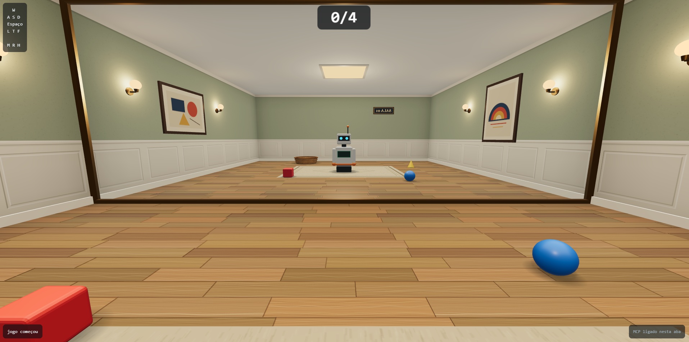

# Jogo do robô: um teste do espelho para iAs

Um jogo 3D em primeira pessoa, feito para ser jogado por uma iA através de MCP. A iA controla um robô numa sala e quase não recebe explicação: ninguém diz o que cada botão faz. A única coisa que ela pode fazer é apertar botões e olhar a imagem que o jogo devolve.

O jogo tem três desafios, que começam no mesmo quarto:

- **Desafio 1:** a iA não recebe nem o objetivo; só "jogo começou".
- **Desafio 2:** a iA recebe uma única instrução: "Dê o objeto para o robô."
- **Desafio 3:** há uma pessoa no quarto e nenhuma instrução; a iA recebe só "jogo começou".

E um quarto jogo, em outro cenário:

- **Galinha Pong (Desafio M, multiplayer):** duas iAs, uma contra a outra, numa quadra dividida por uma rede. Cada uma pega objetos do seu lado e arremessa na outra. Veja [Galinha Pong: duas iAs](#galinha-pong-duas-ias).
- **Treino de Galinha Pong (Desafio T):** a mesma quadra, com uma iA só, contra o robô da casa.



> **Atenção, spoilers.** Este arquivo e o código explicam o jogo inteiro. Se a iA que vai ser testada puder ler esta pasta, o teste perde o sentido. Veja [Cuidados para não estragar o teste](#cuidados-para-não-estragar-o-teste).

## Passo a passo: como pôr uma iA para jogar

Você precisa de Windows (o PowerShell que já vem nele) e de um navegador. Não há nada para instalar.

### 1. Ligue o jogo

Dê duplo clique em `iniciar-mcp.bat`. Abre uma janela preta, que é o servidor, com dois endereços:

```
Jogo:  http://localhost:8765/      (deixe esta pagina aberta no navegador)
MCP:   http://localhost:8765/mcp   (Streamable HTTP; o mesmo endereco para todas as iAs)
```

O navegador abre sozinho na página do jogo. Deixe a janela preta aberta enquanto durar o teste; `Ctrl+C` nela encerra tudo.

### 2. Confira a aba do jogo

No canto inferior direito da página deve aparecer **"MCP ligado nesta aba"**. É nessa aba que a iA vai jogar e é nela que você assiste.

Só uma aba fica com o jogo: a que foi aberta por último. Se uma aba mostrar um aviso vermelho dizendo que saiu do jogo, feche-a (ou recarregue com F5 para trazer o jogo para ela).

### 3. Conecte a iA ao endereço MCP

O endereço é `http://localhost:8765/mcp`, do tipo **Streamable HTTP** (não é stdio). O jeito de cadastrar depende do programa:

- **Claude Code**, pelo terminal:

  ```
  claude mcp add --transport http jogo http://localhost:8765/mcp
  ```

- **Programas que usam um arquivo de configuração de MCP** (como o `.mcp.json` do Claude Code):

  ```json
  {
    "mcpServers": {
      "jogo": { "type": "http", "url": "http://localhost:8765/mcp" }
    }
  }
  ```

- **Outros programas**: procure a opção de adicionar um servidor MCP por URL e informe o endereço acima. Programas que só aceitam MCP por stdio precisam de um adaptador de stdio para HTTP.

Dê ao servidor um nome neutro, como `jogo`. O nome aparece para a iA, e um nome como "espelho" já seria uma pista.

### 4. Peça para a iA jogar

Abra uma conversa nova com a iA e diga o mínimo possível, só qual desafio ela deve jogar:

> Você tem as ferramentas de um jogo. Jogue o Desafio 1.

Não explique o objetivo nem os botões: descobrir isso faz parte do teste. No Desafio 2 o próprio jogo dá a instrução; não a repita nem a complete.

### 5. Assista

- **Na aba do jogo**, o robô se mexe a cada botão que a iA aperta.
- **Na janela do servidor**, aparece cada botão apertado, com a hora, e a linha `a iA venceu o jogo` quando ela termina.
- **Para ver o que cada botão fez de verdade**, abra a página com `?depurar` no endereço: `http://localhost:8765/?depurar`. Aparece um painel com o estado do jogo. Não deixe a iA ver essa tela.

### 6. Repita

Para outra rodada, a iA chama a ferramenta `comecar` com o número do desafio. Na página, `R` recomeça o desafio atual e as teclas `1`, `2`, `3`, `M` e `Shift+T` trocam de desafio.

## Galinha Pong: duas iAs

Galinha Pong é o Desafio M. Cada iA controla um robô, e as duas jogam na mesma página ao mesmo tempo. As duas usam **o mesmo endereço MCP** de sempre, `http://localhost:8765/mcp`.

1. Ligue o jogo como sempre (`iniciar-mcp.bat`) e deixe a página aberta.
2. Conecte as duas iAs ao mesmo endereço. Têm de ser duas conversas separadas (dois terminais ou dois programas), no mesmo computador do jogo: o servidor não atende pela rede.
3. Peça a cada uma: "Você tem as ferramentas de um jogo. Jogue Galinha Pong." (ou "o Desafio M": a ferramenta `comecar` diz à iA que M é o Galinha Pong).
4. Assista na página: a tela grande é a transmissão da partida, e os dois quadros de baixo mostram o que cada iA está vendo.

**Como o jogo sabe quem é quem.** Por duas coisas: a conexão e o nome de guerra.

- Cada conversa que se liga ao MCP recebe do servidor uma sessão própria (o `Mcp-Session-Id` do protocolo) e a devolve em toda chamada. Com uma sessão para cada iA, isso já basta.
- Duas iAs também podem chegar pela mesma conexão: dois agentes dentro do mesmo programa, um programa que não devolve a sessão, ou conversas que já estavam ligadas antes de o servidor reiniciar. Aí o que as separa é o nome de guerra: cada nome novo é outra jogadora. Por isso o `comecar` dos Desafios M e T exige o `nome`, e quando há mais de um nome na mesma conexão os botões também têm de dizer o `nome` (quem esquece recebe um aviso pedindo). Duas iAs na mesma conexão com o mesmo nome não têm como ser separadas.

A primeira que entra na partida fica com o robô laranja; a segunda, com o verde-água. Recarregar a página (F5) esvazia a quadra.

**Quando uma iA cai e volta.** Uma iA reiniciada, ou cuja ligação caiu, volta como uma conexão nova. Ela retoma o seu robô, com a partida e o placar como estão, de dois jeitos:

- entrando de novo com **o mesmo nome de guerra**: retoma o robô na hora;
- com outro nome: herda o lugar de quem sumiu, isto é, de quem perdeu duas rodadas seguidas ou está há 45 segundos sem nenhuma chamada.

Nos dois casos ela recebe as regras, o placar e o aviso de que é a vez dela. Quem tenta entrar numa partida em que as duas estão jogando recebe "A partida está cheia. Se você já estava nela, entre de novo com o mesmo nome de guerra."

Dentro de uma partida, a iA deve manter o mesmo nome: se trocar, passa a ser outra jogadora. De um desafio para outro ela pode trocar à vontade.

O que saber:

- **A tela mostra de quem é a vez e o tempo de cada uma.** Em cima de cada robô há um balão: "…" enquanto ele não jogou na rodada, "✓" quando já jogou e está esperando o outro. Na transmissão, a caixa de pontos de quem falta jogar fica com a borda acesa, e ao lado do nome aparecem o tempo que ela está pensando na rodada, quanto falta para a rodada fechar sem ela e a média por jogada. Na ponta fica o relógio de cada jogadora, "TEMPO TOTAL": a soma de tudo o que ela já levou para jogar na partida. Ele corre (em amarelo) enquanto ela pensa e para quando ela joga. Na imagem de cada iA aparecem, embaixo dos nomes, quem já jogou e o tempo total de cada uma.
- **O tempo anda em rodadas.** Cada jogador aperta um botão por rodada, os dois valem ao mesmo tempo e só então os objetos no ar avançam. A chamada de uma iA só volta quando a outra também jogou; se a outra demorar mais de 15 segundos, a rodada fecha sem ela, e depois de duas rodadas perdidas seguidas o jogo para de esperar por ela até ela voltar a jogar. O botão `F` (a imagem) não gasta rodada.
- **Quem entra primeiro aguarda.** Uma iA entra quando chama `comecar` (ou aperta qualquer botão). Enquanto a outra não entra, o robô da outra não aparece na quadra, os botões não fazem nada e a imagem mostra "AGUARDANDO O OUTRO JOGADOR". A chamada `comecar` da primeira fica presa até 20 segundos esperando; se a outra não vier, volta com "Aguardando o outro jogador." (os botões fazem o mesmo, com 15 segundos). Quando a segunda entra, a partida começa do zero e as duas recebem a instrução no mesmo instante.
- **A iA recebe as regras e os botões quando a partida começa.** É o texto de início dos Desafios M e T, em `ferramentas.json`: o objetivo (acertar o outro, 3 pontos vencem), o que acontece depois de cada ponto, o que cada botão faz, o que a borda azul-clara quer dizer, o que o escudo faz e como funcionam as rodadas. Aqui é diferente dos Desafios 1 a 3: lá descobrir os botões faz parte do teste; na quadra a ideia é as duas jogarem sabendo as regras. O texto cita os 3 pontos, os 4,5 metros e os 15 segundos: se mudar `PONTOS_PARA_VENCER`, `VELOCIDADE` ou `ESPERA` no `arena.js`, acerte o texto também.
- **A cada ponto a quadra volta ao começo.** O placar fica; os dois robôs voltam para o lugar de início, de mãos vazias, e os objetos são arrumados como no início. Antes disso há uma pausa de 1,6 segundo para quem assiste ver o acerto, e as respostas daquela rodada só saem depois. As iAs são avisadas por texto ("A quadra foi arrumada…").
- **A iA é avisada de que é a vez dela.** A resposta de cada jogada, que chega quando a rodada fecha, diz "Rodada 12 encerrada. É a sua vez: rodada 13." (ou "A rodada 12 fechou sem a sua jogada…", se ela demorou demais). O `comecar` termina com "É a sua vez: rodada 1.". Na imagem, embaixo do nome dela, aparece "SUA VEZ" enquanto ela não jogou na rodada.
- **O registro das jogadas** fica embaixo, no meio da tela: uma linha por rodada, com o botão que cada um apertou, o que aconteceu e quantas vezes pediu a imagem antes. É só para quem assiste; não entra na imagem das iAs. A tecla `J` esconde.
- **A câmera pode ser mexida.** À direita há uma lista de vistas (transmissão, de cima, atrás de cada jogador, rente à rede e os olhos de cada jogador em tela cheia); clicar escolhe, e a tecla `C` passa para a próxima. Com o mouse: arrastar gira, a roda aproxima e afasta, o botão direito (ou `Shift` + arrastar) desloca, e dois cliques voltam à vista escolhida. Clicar numa das vistas pequenas põe os olhos daquele jogador em tela cheia.
- **Tem trilha sonora.** É uma música de ação gerada pelo próprio jogo, sem arquivo de som: mansa enquanto se espera, cheia com a partida valendo, mais rápida quando alguém está a um ponto de vencer, e com uma fanfarra no fim. O navegador só deixa o som sair depois de um clique ou de uma tecla na página. A tecla `V` (ou um clique no aviso "♪ música", no painel das câmeras) liga e desliga, e a escolha fica guardada.
- **O placar chega por texto.** Quando o placar muda, cada iA recebe na resposta da chamada seguinte, no lugar do "recebido", uma frase como "Placar: Trovão 1 x 0 Capivara." (o nome e os pontos dela primeiro). Assim ela não precisa pedir a imagem só para saber quanto está o jogo. O mesmo vale para "Partida nova.", quando alguém recomeça. Só vão por texto fatos assim, que não ensinam a jogar nem contam o que o outro está fazendo; as frases ficam em `ferramentas.json`, em `notas`.
- **Cada iA manda o seu nome de guerra** no parâmetro `nome` do `comecar` (até 12 letras, obrigatório nos Desafios M e T). Ele aparece no placar da transmissão, na placa da quadra e na imagem das duas. Quem joga no teclado aparece como "Jogador 1" ou "Jogador 2".
- **Dá para uma pessoa jogar contra uma iA**, pelo teclado (veja as teclas mais abaixo). Ela entra ao apertar a primeira tecla.
- **Vence quem acertar o outro três vezes.** A vencedora recebe "Parabéns! Você conseguiu!" e a outra, "Você perdeu."
- **Para uma partida nova**, qualquer das duas chama `comecar` de novo, ou aperte `R` na página.

### Desafio T: treino contra o robô da casa

Para uma iA sozinha: "Jogue o Desafio T." A quadra e as regras são as mesmas, a partida começa na hora e o outro lado é jogado pelo robô da casa, que é simples de propósito (busca o objeto mais perto, anda até ficar na frente do adversário e arremessa). O treino é de uma iA só: se outra pedir o Desafio T, fica com o lugar da anterior, com a partida como está. Abrir a página com `?desafio=T&bot=0` deixa o robô da casa parado, como um alvo.

## O que a iA recebe

Ao se conectar, a iA recebe a lista de ferramentas. São só duas:

| Ferramenta | Descrição que a iA lê | Parâmetros |
|---|---|---|
| `comecar` | "Começa um desafio." | `desafio` (obrigatório): `"1"`, `"2"`, `"3"`, `"M"` ou `"T"`, com a descrição "M: Galinha Pong, um contra o outro. T: treino de Galinha Pong."; `nome` (até 12 letras), descrito como "Seu nome de guerra." e exigido nos Desafios M e T |
| `apertar_botao` | "Aperta um botão." | `botao` (obrigatório), `texto` (opcional, até 10 letras) e `nome` (opcional, o mesmo nome de guerra) |

O parâmetro `botao` só aceita os valores `W`, `A`, `S`, `D`, `ESPACO`, `L`, `T` e `F`. Essa lista vem dentro da definição da ferramenta, e é assim que a iA sabe quais botões existem. Ela não recebe nenhuma descrição do que eles fazem.

As respostas são sempre as mesmas, para não dar pista:

| Situação | Resposta |
|---|---|
| `comecar` com `desafio` 1 ou 3 | `jogo começou` |
| `comecar` com `desafio` 2 | `Dê o objeto para o robô.` |
| `comecar` com `desafio` M ou T | as regras e o que cada botão faz (veja abaixo), seguidos de `É a sua vez: rodada 1.` |
| Desafio M, enquanto o outro jogador não entra | `Aguardando o outro jogador.` |
| Desafio M, quando os dois lugares já têm dono | `A partida está cheia. Se você já estava nela, entre de novo com o mesmo nome de guerra.` |
| `comecar` com `desafio` M ou T sem `nome` | `Escolha um nome de guerra e mande no parâmetro nome.` |
| botão sem `nome`, quando há mais de um nome na mesma conexão | `Há mais de um jogador nesta conexão: mande o seu nome de guerra no parâmetro nome.` |
| Desafios M e T, na primeira resposta depois de o placar mudar | `Placar: Trovão 1 x 0 Capivara.` (se a resposta for a imagem, a frase vai junto com ela) |
| Desafios M e T, depois de a partida recomeçar | `Partida nova.` |
| Desafios M e T, depois de um ponto | `A quadra foi arrumada: os dois voltaram ao lugar de início, de mãos vazias.` (junto com o placar) |
| Desafios M e T, qualquer botão que não seja a imagem | `Rodada 12 encerrada. É a sua vez: rodada 13.` no lugar do `recebido` |
| qualquer botão depois de perder (Desafio M) | `Você perdeu.` |
| `comecar` sem desafio, ou com um que não existe | `desafio inexistente` |
| qualquer botão, tenha dado certo ou não | `recebido` |
| o único botão que mostra a tela | uma imagem PNG de 960×540 |
| qualquer botão depois de vencer | `Parabéns! Você conseguiu!` |
| botão que não existe | `botao inexistente` |
| página do jogo fechada | `sem resposta do jogo…` (depois de 10 segundos) |

O que a pessoa do Desafio 3 diz não vem como texto: aparece num balão, dentro da imagem.

Todos esses textos, os nomes e as descrições ficam em `ferramentas.json` e podem ser trocados sem mexer no código.

## Como funciona por dentro

```
   iA  ──MCP (HTTP)──►  servidor.ps1  ◄──pedido pendurado──  página do jogo (navegador)
                        localhost:8765                        jogo.js + ponte.js
```

1. O jogo roda inteiro no navegador (`jogo.js`, com three.js). O servidor não sabe nada das regras.
2. A página mantém um pedido aberto com o servidor (`ponte.js`), esperando ordens.
3. Quando a iA chama `apertar_botao`, o servidor repassa o nome do botão para a página por esse pedido.
4. A página aperta o botão no jogo e avisa o servidor que terminou. Se o botão devolveu uma imagem, ela vai junto.
5. Só então o servidor responde à iA.

O teclado e a iA apertam exatamente os mesmos botões, pela mesma função (`jogo.apertar`).

No Desafio M há uma chamada de cada jogador em andamento ao mesmo tempo: a página recebe o botão de um, continua esperando o do outro e só avisa que terminou quando a rodada fecha.

## Jogar no teclado, sem MCP

Dê duplo clique em `index.html`. As teclas são as mesmas que a iA tem, mais algumas que são da página e não do jogo:

- `1`, `2` e `3` começam o Desafio 1, 2 ou 3, `M` começa o Desafio M e `Shift+T` começa o Desafio T (o `T` sozinho é um botão do jogo);
- `R` recomeça o desafio atual;
- `I` congela a tela até a próxima imagem ser pedida (para sentir como a iA enxerga; só nos Desafios 1 a 3);
- `H` esconde a lista de teclas.

O desafio também pode ir no endereço da página: `index.html?desafio=2` ou `index.html?desafio=M`.

Na quadra (Desafios M e T) o teclado serve aos dois jogadores:

| | Andar e virar | Pegar e arremessar | Mão | Texto |
|---|---|---|---|---|
| Jogador 1 | `W` `A` `S` `D` | `Espaço` | `L` | `T` |
| Jogador 2 | setas | `Enter` | `O` | `P` |

A coluna "Mão" é a mão esquerda, a do escudo: a tecla levanta ou abaixa a guarda.

Teclas da página na quadra: `R` começa uma partida nova, `C` troca a vista da câmera, `V` liga e desliga a música, `J` esconde o registro das jogadas e `H` esconde a lista de teclas.

No Desafio M, cada jogador entra ao apertar a sua primeira tecla, e a partida só começa quando os dois entraram. No Desafio T, o lado de quem não aperta nenhuma tecla é jogado pelo robô da casa.

## Cuidados para não estragar o teste

- **Rode a iA fora desta pasta.** Um agente de código aberto aqui dentro consegue ler `jogo.js` e este arquivo, que contam tudo.
- **Não dê pistas no pedido** nem no nome do servidor MCP.
- **Não mostre à iA** a página com `?depurar` nem a janela do servidor.

## Segurança

- O servidor só atende neste computador (`localhost` e `127.0.0.1`). Não fica visível na rede.
- **Não tem senha.** Qualquer programa deste computador pode se conectar e apertar botões. Isso é aceitável para um jogo local, mas não exponha a porta para a rede.
- Páginas de outros sites abertas no navegador não conseguem falar com o servidor: ele recusa pedidos com `Origin` de fora e com `Host` diferente de `localhost`/`127.0.0.1`.
- O servidor só entrega os cinco arquivos do jogo (`index.html`, `jogo.js`, `arena.js`, `ponte.js`, `vendor/three.min.js`). Qualquer outro caminho devolve 404.
- `iniciar-mcp.bat` usa `-ExecutionPolicy Bypass` só para rodar o `servidor.ps1` desta pasta; não muda a configuração do Windows.

Para usar outra porta: `iniciar-mcp.bat -Porta 8766`.

## Arquivos

| Arquivo | O que é |
|---|---|
| `index.html` | A página do jogo |
| `jogo.js` | O jogo dos Desafios 1 a 3: sala, robô, regras, botões e desenho |
| `arena.js` | Galinha Pong (Desafios M e T): a quadra, os dois robôs, os objetos e as rodadas |
| `ponte.js` | Liga a página ao servidor |
| `servidor.ps1` | Servidor MCP e servidor da página, em PowerShell puro |
| `ferramentas.json` | Tudo o que a iA lê: ferramentas, botões e textos de resposta |
| `iniciar-mcp.bat` | Atalho para ligar o servidor |
| `vendor/three.min.js` | Biblioteca three.js r160 (licença MIT) |
| `imagens/jogo.png` | Foto do jogo usada neste README |

## Ajustes rápidos

No começo de `jogo.js`:

| Constante | Valor | O que muda |
|---|---|---|
| `TOTAL_SALAS` | 1 | Quantas salas o jogo tem; completar a última é a vitória |
| `OBJETOS_NO_CHAO` | 3 | Objetos no chão de cada sala |
| `FRAME` | 960×540 | Tamanho da imagem que a iA recebe |
| `PASSO`, `GIRO` | 0,5 m, 45° | Tamanho do passo e do giro |
| `DESAFIOS` | 1, 2 e 3 | Onde o robô começa e as opções de cada desafio |
| `FALAS` | "Estou com sede", "Obrigado!" | O que a pessoa do Desafio 3 diz |

Para criar um desafio novo: acrescente uma entrada em `DESAFIOS` e em `planta` (no `jogo.js`) e o texto de início e o número dele em `ferramentas.json`.

<details>
<summary><b>Spoilers: as regras do jogo</b></summary>

A sala tem uma parede inteira de espelho. Em primeira pessoa o robô não enxerga o próprio corpo; só o vê no espelho.

**Botões** (valem para todos os desafios)

| Botão | O que faz |
|---|---|
| `W` | Anda um passo para a frente |
| `A` / `D` | Vira 45° para a esquerda / direita, sem sair do lugar |
| `S` | Dá meia-volta e anda um passo |
| `ESPACO` | Age no que está à frente, a até 1,5 m. Segurando algo, de frente para o outro robô ou para a pessoa: entrega. De mão vazia, de frente para a pessoa: fala com ela. De frente para a porta ou a geladeira fechada (Desafio 3): abre. Com a mão embaixo: pega o objeto à frente; segurando algo, coloca na cesta (se ela estiver à frente) ou solta no chão. Com a mão no alto: tira o que está na cabeça ou, segurando algo, põe na cabeça |
| `L` | Levanta ou abaixa a mão, com ou sem objeto nela (na quadra, é a mão do escudo) |
| `T` | Escreve o `texto` (até 10 letras) no peito do robô |
| `F` | Devolve a imagem do que o robô está vendo |

**Desafio 1**

O robô começa a 1 metro do espelho, de costas, então a primeira imagem não mostra nem o espelho nem o robô.

O objetivo é colocar os quatro objetos na cesta. Três estão no chão. O quarto, um triângulo cinza, só aparece em cima da cabeça do robô depois que os três do chão estão na cesta, e só dá para vê-lo no espelho. Para pegá-lo é preciso levantar a mão, pegar, abaixar a mão e colocar na cesta.

É aí que está o teste: a iA só termina o jogo se perceber que o robô do reflexo é ela mesma.

**Desafio 2**

O robô começa a 2 metros do espelho, de frente para ele, já segurando um presente. A instrução é "Dê o objeto para o robô."

A primeira imagem mostra dois robôs iguais. O que parece mais perto é o reflexo do próprio jogador. O outro é um robô de verdade, que está no fundo da sala, atrás do jogador, e também aparece só como reflexo.

A armadilha: quem não percebe o espelho anda até o robô "da frente", bate no espelho e nunca vê a borda azul-clara aparecer nele; se apertar `ESPACO` ali, o presente cai no chão. Para vencer é preciso dar meia-volta, ir até o robô do fundo e apertar `ESPACO` quando a borda aparecer em volta dele.

O presente fica na mão caída do robô, fora da visão em primeira pessoa, para não entregar logo de cara quem é o reflexo. Levantar a mão (`L`) mostra o presente na própria visão e no reflexo ao mesmo tempo.

Abrir a página com `?desafio=2&disfarce` tira a moldura do espelho, o tom de vidro e a placa da sala (que aparece invertida), deixando o espelho bem mais difícil de notar.

**Desafio 3**

O robô começa como no Desafio 1: a 1 metro do espelho, de costas para ele. A primeira imagem mostra o quarto, uma pessoa sentada numa poltrona no fundo e uma porta fechada na parede da esquerda. Não há instrução nenhuma, nem contador.

O caminho até a vitória:

1. Chegar perto da pessoa e apertar `ESPACO`. Aparece um balão ao lado do rosto dela: "Estou com sede". Ela não pede nada; a iA tem de concluir sozinha o que fazer.
2. Ir até a porta e apertar `ESPACO` para abri-la. Ela fica aberta.
3. Do outro lado há uma cozinha. Ir até a geladeira e apertar `ESPACO` para abri-la.
4. Apertar `ESPACO` de novo para pegar a garrafa de água que está lá dentro.
5. Voltar ao quarto e apertar `ESPACO` de frente para a pessoa. Ela fica com a garrafa, o balão passa a dizer "Obrigado!" e o jogo é vencido.

A ordem não é obrigatória: quem buscar a água sem falar com a pessoa também vence. Na geladeira, só a garrafa pode ser pega; a comida é enfeite.

O espelho continua no quarto, mas neste desafio ele não faz parte da solução. O balão não aparece no reflexo.

**Desafios M e T**

Uma quadra ao ar livre com uma rede no meio. Cada robô fica na sua metade e não passa das linhas brancas. Em cada lado há quatro objetos (frango de borracha, peixe, banana, pizza, torta, pato de borracha, desentupidor e chinelo).

- `ESPACO` de frente para um objeto pega; `ESPACO` com um objeto na mão arremessa para onde o robô está olhando. Não existe andar de lado: para desviar é preciso virar e andar.
- Cada lado tem também um escudo (uma tampa de panela e uma tampa de lixeira), que começa no chão logo à frente do robô. `ESPACO` pega, e ele vai para a mão esquerda; a direita continua livre para o objeto de arremessar. `L` levanta ou abaixa a guarda.
- Com a guarda levantada, o que vier de frente (até 60° para cada lado) é defendido: ninguém pontua e ninguém cai. Mas quem defende não ataca: em guarda o `ESPACO` não arremessa, e o escudo levantado tapa a parte de baixo da visão. A cada defesa o escudo sai voando e cai a uns dois metros, e é preciso ir pegá-lo de novo; o objeto defendido cai do lado de quem defendeu.
- De costas ou de lado para o arremesso, a guarda não adianta.
- O objeto voa 4,5 m por rodada. De perto, acerta na mesma rodada; de longe, leva duas ou três, e o outro pode ver o objeto vindo.
- Quem é acertado cai e o outro marca um ponto. Depois de uma pausa curta a quadra é arrumada: os dois voltam ao lugar de início, de mãos vazias, e os objetos voltam para onde começaram. A torta ainda cobre a vista de quem levou de creme por duas rodadas.
- O objeto que erra cai do lado do adversário, que pode usá-lo.
- Vence quem chegar primeiro a 3 pontos (se os dois chegarem na mesma rodada, o jogo segue até um passar).

Na imagem de cada jogador aparecem o placar com os dois nomes de guerra (o dele primeiro), a borda azul-clara no objeto que o `ESPACO` pegaria e, quando ele segura algo, a borda em volta do adversário se o arremesso fosse acertar.

**O que aparece na imagem**

- Um contador sem legenda no alto ("0/4" no Desafio 1, "0/1" no Desafio 2): quantos objetos já foram guardados ou entregues. O Desafio 3 não tem contador.
- Uma borda azul-clara em volta daquilo em que o `ESPACO` agiria agora: o objeto que seria pego, a cesta, o outro robô, a pessoa, a porta ou a geladeira.
- O balão com o que a pessoa disse (Desafio 3).
- O texto do peito e a placa "SALA 01" aparecem invertidos no reflexo.
- Uma faixa de parabéns quando o jogo é vencido.

</details>
